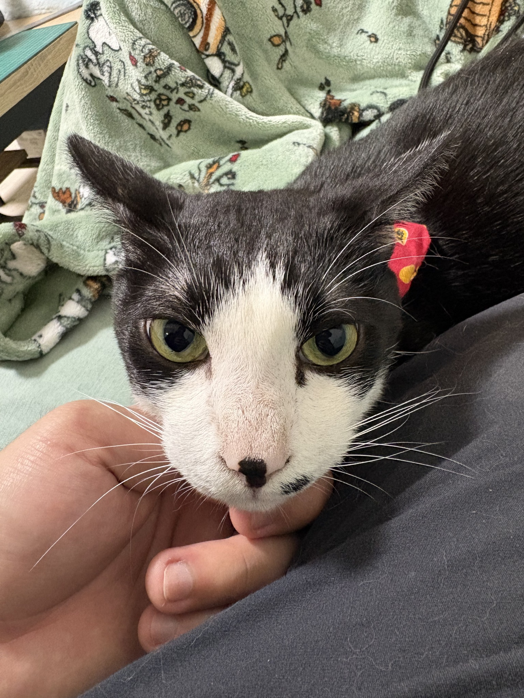

# 紀念我的貓 點點



## [⬇️ 點這裡下載完整 V1.0.0（含 EXE）](https://github.com/jerrychien1688/diandian-desktop-pet/archive/refs/heads/main.zip)

**按上面的連結即可下載，裡面已經有能直接開啟的程式。**

### 下載後，照這三步開啟

1. **下載**：按上方連結，將 ZIP 壓縮檔存到電腦。
2. **解壓縮**：在下載的 ZIP 上按右鍵，選「全部解壓縮」。建議解壓縮到「文件」等可寫入的資料夾。
3. **開啟**：打開解壓縮後的資料夾，找到 **`DiandianPet.exe`**，連點兩下，點點就會出現在主要螢幕右下角。

請先解壓縮，再開啟程式。一般使用不需要輸入指令或自行編譯，也不用安裝 Python、Node.js 或下載 AI 模型。

也可以[只下載 DiandianPet.exe](https://github.com/jerrychien1688/diandian-desktop-pet/raw/refs/heads/main/DiandianPet.exe)，存到可寫入的資料夾後連點兩下開啟。

需要 Windows 桌面環境與 .NET Framework 4.8。三張姿勢素材已內嵌，單獨下載 EXE 也能開啟。若舊版仍在執行，請先由點點的右鍵選單結束。

## 這一版有哪些功能？

V1.0.0 是以點點的照片製作的 Windows 桌寵，提供坐姿、趴姿、睡姿，搭配呼吸效果、摸摸愛心、拖曳移動與縮放。

| 操作 | 功能 |
|---|---|
| 按住點點拖曳 | 移動位置 |
| 點一下 | 顯示摸摸愛心 |
| 連點兩下 | 依序切換坐姿、趴姿、睡姿 |
| 游標放在點點身上並轉動滾輪 | 縮放大小 |
| 按右鍵 | 選姿勢、自動換姿勢、呼吸、大小、置頂、隱藏或結束 |
| 點工作列右下角的點點圖示 | 叫回被隱藏的點點；必要時先展開隱藏圖示 |

自動換姿勢依序為坐姿約 55 秒、趴姿約 55 秒、睡姿約 90 秒。手動換姿勢會暫停自動切換，可從右鍵選單重新開啟。

程式限制為單一執行個體。完全結束請在點點身上按右鍵，選「結束點點桌寵」。

找不到點點時，先確認程式仍在執行，或重新開啟 `DiandianPet.exe`。

## 設定與資料

位置、大小與偏好會儲存在執行檔旁的 `Settings.ini`。如果所在資料夾無法寫入，仍可使用，但重開後可能回到預設值。

程式離線執行，不需要登入、不讀取照片庫、不連網，不會修改來源照片、影片或 ZIP，也不會自行加入開機啟動或安裝系統服務。

## 素材與動畫

| 姿勢 | 來源照片 |
|---|---|
| 坐姿 | P04133 · IMG_8399.HEIC |
| 趴姿 | P04482 · IMG_0157.HEIC |
| 睡姿 | P01465 · IMG_3498.HEIC |

素材經 AI 輔助去背與重建，毛髮、臉型及姿勢細節可能與原照不同；鼻頭與嘴邊黑點保留作為辨識特徵。

V1 是三張照片姿勢加上程式呼吸與互動效果，換姿勢使用淡入；尚未加入走路、轉身或舔毛等連續動作。素材來源與處理方式記錄在 [SOURCE_ASSETS.json](SOURCE_ASSETS.json)。

## 完整套件內容

本套件同時提供可直接執行的程式與可重新編譯的原始碼。按上方下載連結，或從專案首頁選擇「Code → Download ZIP」，即可取得目前 `main` 的完整套件。

- `DiandianPet.exe`：已編譯好的 V1 主程式，連點兩下即可開啟。
- `README.md`：下載、操作與建置說明。
- `CHANGELOG.md`：版本更新紀錄。
- `assets/`：三張透明姿勢素材，編譯時會嵌入執行檔。
- `source/`：主程式 C# 原始碼、`Build.ps1` 建置腳本與 `app.manifest`。
- `docs/images/`：README 使用的點點生活照。
- `SOURCE_ASSETS.json`：素材來源與處理方式。

一般使用只需開啟 EXE；想修改程式的人可使用原始碼與素材重新編譯。所有操作與建置說明都整合在根目錄這一份 README.md。

## 驗證

附上的 EXE 由對應 V1 原始碼重新編譯，已在這台 Windows 電腦通過 10 項內建檢查，涵蓋透明無框視窗、三種素材的透明度與呈現、縮放上下限、螢幕邊界、呼吸暫停、自動換姿勢、選單與通知區圖示。

負座標螢幕邊界為模擬檢查，尚未完整實測不同電腦或混合 DPI 多螢幕環境。測試結果與預覽圖片可用下方的內建測試指令重新產生。

<details>
<summary>給開發者：自行編譯與執行內建測試</summary>

完整套件已包含 EXE。只有想自行修改或重新編譯時，才需要以下步驟。

使用 C#、WPF 與 .NET Framework 4.8，未使用第三方執行期套件。解壓縮後，在 PowerShell 切換到專案根目錄：

```powershell
.\source\Build.ps1
.\DiandianPet.exe
```

建置腳本使用 Windows 的 .NET Framework C# 編譯器、WPF、System.Drawing 與 Windows Forms，將三張姿勢素材內嵌至執行檔。

WPF 透明視窗的參考文件：[AllowsTransparency](https://learn.microsoft.com/en-us/dotnet/api/system.windows.window.allowstransparency)與[WPF 視窗概觀](https://learn.microsoft.com/en-us/dotnet/desktop/wpf/windows/)。

三個姿勢已整理為同尺寸透明畫布，建置與啟動不需要存取原始相簿。

內建測試建議輸出到暫存目錄：

```powershell
$testOutput = Join-Path $env:TEMP 'Diandian-v1-self-test'
Start-Process -FilePath (Join-Path $PWD 'DiandianPet.exe') -ArgumentList @('--self-test', ('"' + $testOutput + '"')) -Wait
Get-Content (Join-Path $testOutput 'self-test.txt')
```

</details>

## 更新紀錄

[V1.0.0 更新紀錄](CHANGELOG.md)：首次提供三姿勢桌寵及基本互動。

## 照片與素材使用

點點的生活照與動畫素材屬個人紀念資料，目前未另行授予開源或照片再利用授權。
